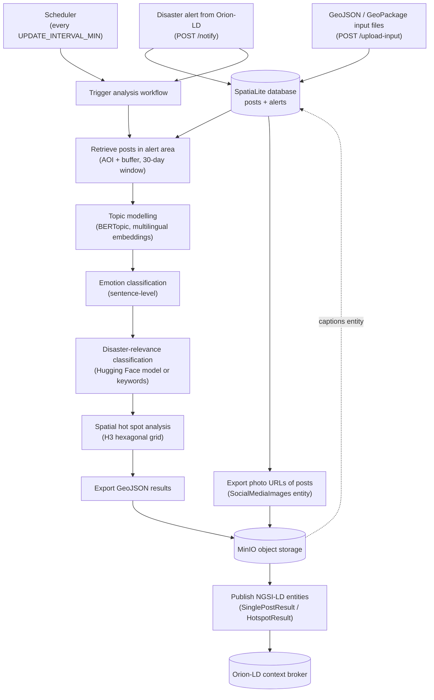

# GeoSocial Media Analytics: TEMA TFA11

This repository contains the **TFA-11 geo-social media analytics component** developed by the [GeoSocial AI](https://it-u.at/en/research/research-groups/geosocial-ai/) research group at [Interdiscplinary Transformation University (IT:U)](https://it-u.at/en/) within the [Horizon Europe project TEMA](https://tema-project.eu). The component ingests geo-referenced social media posts, runs an automated text and spatial analysis pipeline whenever a disaster alert (e.g. flood or wildfire) is received, and publishes the results as GeoJSON files to an S3-compatible object storage together with NGSI-LD metadata entities on a context broker.

## What the component does

The component implements an alert-driven geosocial media analytics pipeline for disaster
response. For each disaster alert (e.g. a flood or wildfire event), it retrieves geolocated
social media posts from the affected area and time window, enriches them with semantic and
geospatial information, and derives two complementary products: a post-level analysis
(`SinglePostResult`) and a grid-based statistical assessment of disaster-related activity
(`HotspotResult`). The pipeline comprises the following stages:

1. **Alert ingestion and triggering.** Disaster alerts are received as NGSI-LD entities from
   an Orion-LD context broker and persisted in the component's local SpatiaLite database.
   Each incoming alert triggers the analysis workflow, which is additionally re-executed on a
   configurable schedule for all non-expired alerts.

2. **Spatio-temporal data retrieval.** Posts are selected from the database that fall within
   the alert's area of interest, extended by a configurable buffer, and that were published
   within a 30-day window preceding the alert.

3. **Semantic text analysis.** Each retrieved post is processed by a multilingual NLP pipeline:
   - *Topic modelling*: Unsupervised topic modelling with BERTopic, combining multilingual
     sentence embeddings with UMAP dimensionality reduction; every post is assigned a topic
     label and representative keywords.
   - *Emotion classification*: Per-post emotion recognition with a multilingual transformer
     model, retaining only labels above a configurable probability threshold.
   - *Disaster-relevance scoring*: Each post is scored for its relevance (0.0 to 1.0) the
     disaster event with a fine-tuned multilingual transformer classifier. Textual relevance is combined with exponential spatial and temporal decay functions that weight each post by its spatial distance to and temporal distance from the alert.
   - *Disaster-relatedness classification*: Each post is classified for binary 
     disaster-relatedness using either a multilingual transformer model or a list of pre-defined keywords (configurable).

4. **Spatial hot spot analysis.** Disaster-related posts are aggregated on an H3 hexagonal
   grid at a configurable resolution. For each grid cell, the local spatial autocorrelation
   statistic Gi\* (Getis–Ord) is computed on the share of disaster-related posts, identifying
   statistically significant hot spots of disaster-related activity at the 90%, 95% and 99%
   confidence levels.

5. **Result publication.** The post-level results and the H3-based hot spots are exported as
   GeoJSON files, stored in an S3-compatible object storage (MinIO), and published as
   `SinglePostResult` and `HotspotResult` NGSI-LD entities on the context broker for
   consumption by downstream services.

In addition, the component supports a **multimodal extension**: posts containing images are
exported as `SocialMediaImages` entities so that an external image-language model can generate
captions, which are written back to the database once the corresponding entity is received.

Post data is ingested from GeoJSON/GeoPackage files via an upload endpoint (see
[Providing input data](#providing-input-data)). The methodological foundations of the analysis
pipeline are described in the publications listed under [References](#references).

## Workflow

The diagram below shows the functionality of the component that is actually used. Analysis is
triggered when a new alert arrives or when the scheduler fires; post data is ingested from
GeoJSON/GeoPackage files.



## Getting started

### Prerequisites

- Docker (a GPU is optional; the component falls back to CPU if none is available)
- Access to a MinIO (or other S3-compatible) object storage and an Orion-LD context broker

### Build and run

```bash
git clone <repository_url>
cd <repository_directory>

docker build -t tfa-11 .
docker run -p 5007:5007 --gpus all \
  -e MINIO_ENDPOINT=<endpoint> \
  -e MINIO_ACCESS_KEY=<access_key> \
  -e MINIO_SECRET_KEY=<secret_key> \
  -e MINIO_BUCKET_NAME=<bucket> \
  -e ORION_LD_ENDPOINT=<orion_url> \
  -e ORION_BASE_URL=<orion_url>/ngsi-ld/v1/entities \
  -e PUBLIC_IP_ADDRESS=<public_host_address> \
  tfa-11
```

Alternatively, create a `.env` file with the variables listed below and run the component with
`docker compose up --build`.

The Flask API including an interactive SwaggerUI documentation is then available at
`http://localhost:5007/tfa11/apidocs` (i.e. `${BASE_PATH}/apidocs`).

### Providing input data

Social media posts are read from `.geojson` or `.gpkg` files that must contain the following
columns:

| Column | Description |
|---|---|
| `message_id` | Unique ID of the post |
| `date` | Timestamp of the post |
| `text` | Text content of the post (usernames and links are normalised on ingest) |
| `photo_url` | URL of an attached photo, if any |
| `geometry` | Geographic location of the post (may be empty) |
| `source` | Source platform of the post |

Files can either be placed in `app/data/input_data/` before building the image (they are loaded
on startup) or uploaded at runtime via the `POST /upload-input` endpoint. The data is inserted
into the component's SpatiaLite database.

### Viewing results

- `GET /get-single-post-result` and `GET /get-hotspot-result` serve the latest result GeoJSON
  files directly from the container.
- `result-viewer.html` in this repository is a standalone web page that loads and visualises the
  latest results on a map; open it in a browser and set the base URL of your component instance.

## Configuration

All settings are configured via environment variables:

| Variable | Description |
|---|---|
| `PORT` | Port the application listens on (default: `5007`) |
| `BASE_PATH` | Base path of the application (default: `/tfa11`) |
| `PUBLIC_IP_ADDRESS` | Public address of the host, used for broker subscription callbacks |
| `MINIO_ENDPOINT` | MinIO / S3 endpoint |
| `MINIO_ACCESS_KEY` | MinIO access key |
| `MINIO_SECRET_KEY` | MinIO secret key |
| `MINIO_BUCKET_NAME` | MinIO bucket for uploads and downloads |
| `ORION_LD_ENDPOINT` | Orion-LD context broker endpoint |
| `ORION_BASE_URL` | Base URL for Orion-LD entity operations (default: `${ORION_LD_ENDPOINT}/ngsi-ld/v1/entities`) |
| `PARTNER_ID` | Partner identifier used in entity IDs (default: `PLUS-tfa11`) |
| `BROKER_TYPE_ID` | Entity type to subscribe to for alerts (default: `Alert`) |
| `BROKER_SUBSCRIPTION_ID` | Identifier for the broker subscription |
| `DB_CONN_STRING` | Database connection string (default: local SpatiaLite file) |
| `UPDATE_INTERVAL_MIN` | Interval in minutes for the scheduled workflow (default: `1440`) |
| `AOI_BUFFER_M` | Buffer around the alert area of interest in metres (default: `20000`) |
| `H3_RESOLUTION` | H3 resolution used for the hot spot analysis (default: `7`) |
| `HOTSPOTS_DATE_RANGE` | Date range considered for hot spots |
| `EMOTION_MODEL` | Hugging Face model for emotion classification (default: `MilaNLProc/xlm-emo-t`) |
| `EMBEDDING_MODEL` | Hugging Face embedding model for topic modelling (default: `intfloat/multilingual-e5-small`) |
| `RELATEDNESS_METHOD` | Disaster-relevance classification method: a Hugging Face model name or `keywords` (default: `keywords`) |
| `KEYWORDS` | Pipe-separated keyword regex used when `RELATEDNESS_METHOD=keywords` |
| `EMOTION_ANALYSIS_PROBABILITY_THRESHOLD` | Probability threshold for emotion labels (default: `0.5`) |
| `LIVE_MODE` | If `True`, only posts up to `now()` are considered (default: `False`) |
| `FLASK_SECRET_KEY` | Secret key for the Flask application |
| `TZ` | Timezone of the component (default: `Europe/Vienna`) |
| `DEBUG` | Enable debug mode (default: `false`) |
| `LOG_PATH` | Path of the log file (default: `./logs/app.log`) |
| `DATA_STORAGE` | Optional Google Drive folder URL to download input data from |

## License

This project is licensed under the MIT License — see the [LICENSE](LICENSE) file for details.

## Acknowledgements

This software was developed as part of the TEMA project, which has received funding from the
European Union's Horizon Europe research and innovation programme (grant agreement no. 101093003).

## References

The component builds on the following methods, developed throughout the TEMA project:

- Hanny, D., Kramer, A., Jalilian, E., Schmidt, S., & Resch, B. (2026). Towards Fine-grained Relevance Scoring of Social Media Posts in Disaster Response: A Decay-based Regression Approach. AGILE: GIScience Series, 7, 1–15. https://doi.org/10.5194/agile-giss-7-4-2026
- Hanny, D., & Resch, B. (2025). Multimodal GeoAI: An integrated spatio-temporal topic-sentiment model for the analysis of geo-social media posts for disaster management. International Journal of Applied Earth Observation and Geoinformation, 139, 104540. https://doi.org/10.1016/j.jag.2025.104540
- Hanny, D., Schmidt, S., Gandhi, S., Granitzer, M., & Resch, B. (2026). A multimodal GeoAI approach to combining text with spatiotemporal features for enhanced relevance classification of social media posts in disaster response. Big Earth Data, 10(1), 258–302. https://doi.org/10.1080/20964471.2025.2572140
- Hanny, D., Schmidt, S., & Resch, B. (2024). Active Learning for Identifying Disaster-Related Tweets: A Comparison with Keyword Filtering and Generic Fine-Tuning. In K. Arai (Ed.), Intelligent Systems and Applications (pp. 126–142). Springer Nature Switzerland. https://doi.org/10.1007/978-3-031-66428-1_8
- Schmidt, S., Díaz Fragachan, E., Arifi, D., Hanny, D., & Resch, B. (2025). Assessing the spatial accuracy of geocoding flood-related imagery using Vision Language Models. Spatial Information Research, 33(2), 15. https://doi.org/10.1007/s41324-025-00609-0
- Schmidt, S., Friedemann, M., Hanny, D., Resch, B., Riedlinger, T., & Mühlbauer, M. (2025). Enhancing satellite-based emergency mapping: Identifying wildfires through geo-social media analysis. Big Earth Data, 0(0), 1–23. https://doi.org/10.1080/20964471.2025.2454526
